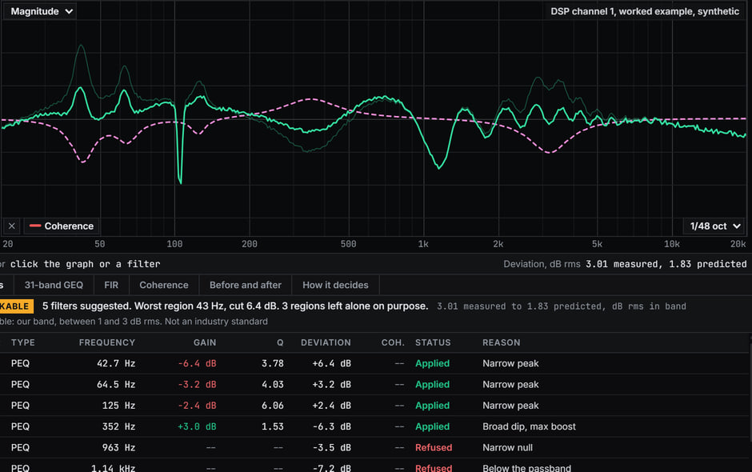

  

# NETLCO Align

**Sound system tuning and audio measurement software.** Measure a sound system with one application and see what to change: stages, venues and churches, the level at live shows, cinemas and home theatres, and cars.

Open it in the browser: **[alignbynetlco.com](https://alignbynetlco.com/)**

Made by [Nomad Enterprise TechSolutions Limited (NETLCO)](https://netlco.com/), Trinidad and Tobago.

*The [EQ](https://alignbynetlco.com/tools/eq) tool on a worked example: each filter it suggests, applied or refused, with the reason.*

## The tools

Align is free to start: the RTA, the spectrograph, the SPL meter, pink noise and the Fill and delay planner run with no account. Pro opens every other tool for one payment of US$199 ([prices](https://alignbynetlco.com/prices)).

| Tool | What it does | Plan |
|---|---|---|
| [RTA](https://alignbynetlco.com/tools/rta) | The spectrum of what the microphone hears, live: a line for every frequency, and bars from whole octaves down to 1/24 octave with a held peak above each. | Free |
| [SPL meter](https://alignbynetlco.com/tools/spl-meter) | Sound level in A, C and Z weighting, Fast and Slow, with three Leq at once, LCpeak, LZpeak, the crest factor and timed runs. | Free |
| [Transfer function and delay](https://alignbynetlco.com/tools/transfer-function) | The system's magnitude, phase and coherence against what it is fed, with the delay found and inserted, live from up to 16 inputs. | Pro |
| [EQ](https://alignbynetlco.com/tools/eq) | Filters fitted to your target by three rules, with a plain reason for every region it leaves alone. | Pro |
| [Align the bands](https://alignbynetlco.com/tools/align-the-bands) | Two bands that add where they overlap: Auto Phase finds the delay and polarity, and offers an all-pass where those cannot. | Pro |
| [Auto crossover](https://alignbynetlco.com/tools/auto-crossover) | Crossovers between two measured drivers, tried as Linkwitz-Riley and Butterworth from 12 to 48 dB an octave, ranked by how cleanly the two hand over. | Pro |
| [Filters and targets](https://alignbynetlco.com/tools/filters-and-targets) | Your own filters beside the automatic EQ, and a target to fit toward: Flat, X-Curve gentle, House Curve, Outdoor curve or Custom. | Pro |
| [FIR](https://alignbynetlco.com/tools/fir) | An FIR at your processor's own taps and rate, made from the EQ, that can correct the speaker's own phase too. | Pro |
| [Impulse and room](https://alignbynetlco.com/tools/impulse) | A log sweep impulse, distortion from the same sweep, EDT, T20 and T30 per octave, C50 and C80. | Pro |
| [Sub map](https://alignbynetlco.com/tools/sub-map) | Subs and tops on a stage, summed as pressure over a map of the venue, with Auto delay and polarity setting each sub for the best sum. | Pro |
| [Speaker limiter](https://alignbynetlco.com/tools/speaker-limiter) | RMS and peak limiter thresholds and times from a driver's and an amplifier's ratings, by three makers' published notes. | Pro |

## Learn

- [Videos](https://alignbynetlco.com/videos): short answers to what engineers ask about watts, subs, horns, crossovers and rooms, each with the Align tool that measures it.
- [Training](https://alignbynetlco.com/training): learn to measure and tune a sound system with Align, seven lessons in the order the trade works. Free to read, no account.
- [Compare](https://alignbynetlco.com/compare): five sound system measurement tools side by side (Align, RiTA, Open Sound Meter, SATlive and FLUX MiRA Live): where each runs, what it costs, and 50 features.
- [What's new](https://alignbynetlco.com/changelog)

## Contact

[alignbynetlco.com/contact](https://alignbynetlco.com/contact)

This repository is Align's public page.
